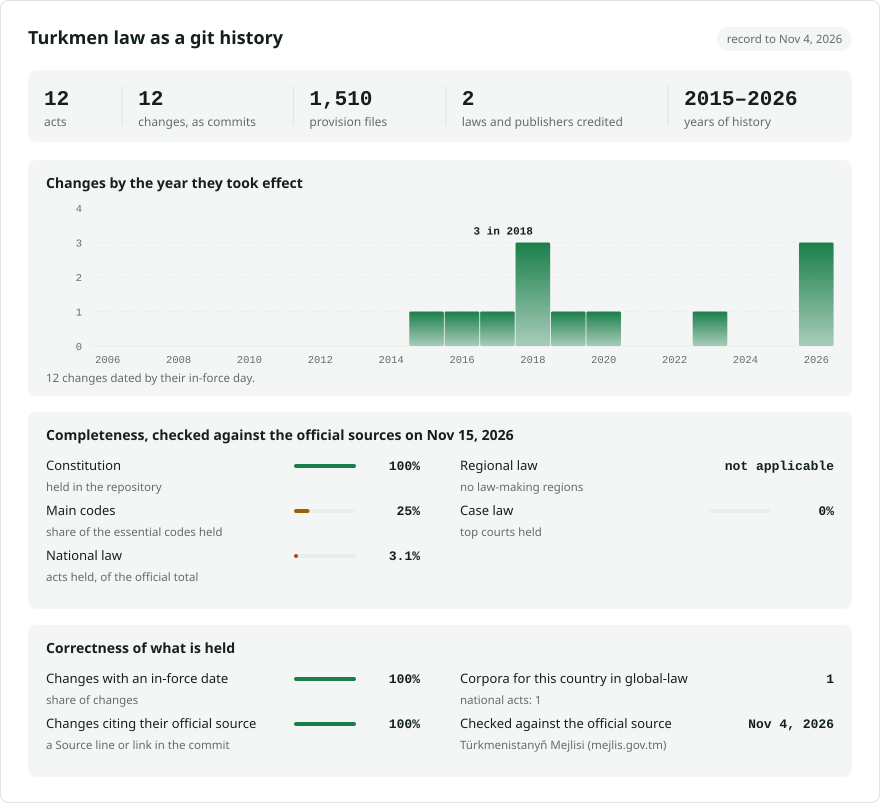

# Turkmenistan: law history in git

[Türkmen dili](README.md) · **English**

<picture>
<source media="(prefers-color-scheme: dark)" srcset="data/effort-dark.svg">

</picture>

The law of Turkmenistan as a git history: one file per article (one per law for ten laws kept whole), one commit per version on the day it took effect, and the law that made each change as the commit's author (the publisher, for the oldest version available). `git blame` names the act behind every line; `git log` lists every change to an article; picking a date gives the text in force that day.

Part of [lexifina/global-law](https://github.com/lexifina/global-law), one git history for every country's law: this is Turkmenistan's national law, which global-law reads at `turkmenistan/national/acts/`.

**What is in it now:** 12 acts from the Mejlis, each in one version so far: the Constitution (the 2016 revision as amended in 2017, 2020 and 2023), the Civil Code of 28 June 2025, in force from 1 January 2026, and ten laws that took effect between 2015 and 2026, among them those on countering extremism, personal data, narcotic drugs, blood donation and virtual assets. [`REPRODUCE.md`](REPRODUCE.md) lists them with their dates; [`data/laws.csv`](data/laws.csv) lists the two laws the record names.

The Constitution is `konstitusiya/` and the Civil Code `rayat-kodeksi/`: one file per article (`art-050.md`; article 6¹ is `art-006-1.md`), `preambula.md`, the headings of their parts, sections and chapters in `bolumler.md`, and a `README.md` listing them. Each of the ten laws is the whole official text in one file, `mejlis-law-<id>/full-text.md`, by its page id on mejlis.gov.tm (`mejlis-law-378/` is Wirtual aktiwler hakynda, the Law on Virtual Assets).

The text is in Turkmen, the state language (article 21 of the Constitution), as the Mejlis publishes it. Russian and English texts are not part of this record.

## Questions as git commands

| Question | Command |
| --- | --- |
| Every change to Article 50 of the Constitution (the right to rest) | `git log -p --word-diff -- konstitusiya/art-050.md` |
| Which act wrote each line of Article 50? | `git blame konstitusiya/art-050.md` |
| Every version of the Constitution, with the day each took effect | `git log --format="%h %(trailers:key=In-force,valueonly,separator=) %an" -- konstitusiya ":(exclude)konstitusiya/README.md"` |
| Article 50 as in force on 1 January 2024 | `python tools/on.py 2024-01-01 konstitusiya art-050` |

**Outside git**, we also host this record publicly, for free:

- **[Ask Claude about the law of Turkmenistan](https://global-law.lexifina.com/v1/try_claude?country=turkmenistan)**: opens Claude with a first question ready.
- **[Ask ChatGPT](https://global-law.lexifina.com/v1/try_chatgpt?country=turkmenistan)**: the same question in ChatGPT.
- **[Search Turkmenistan's law on our site](https://lexifina.com/law?country=turkmenistan&q=miras)**: a search for "miras" (inheritance), with each provision's text and its versions, no account needed.
- **[Developer REST API](https://global-law.lexifina.com/v1/search_law?query=miras&jurisdiction=turkmenistan)**: the same search as JSON, with no key. See the [documentation here](https://lexifina.com/api/global-law).

Both assistants read the record through the free Global law connector (MCP, `https://global-law.lexifina.com/mcp`); the first time, the chat gives you the link that adds it. Ask in Turkmen or in English.

**Host it yourself easily.** All it takes is git and Python, and the tools run on your machine:

```sh
git clone --depth 1 https://github.com/lexifina/global-law && cd global-law
python3 tools/countries.py add turkmenistan/national/acts
python3 tools/law.py show 2024-01-01 turkmenistan/national/acts/konstitusiya/art-050.md
```

Opened in Claude Code, Cursor, VS Code or Codex, the clone also starts a local MCP server with the same tools ([MCP.md](https://github.com/lexifina/global-law/blob/main/MCP.md)).

## Dates

Each commit is dated at noon, Asia/Ashgabat, on the day the version took effect, and carries it in its `In-force:` trailer:

- for the Constitution, 21 January 2023, the day Constitutional Law No. 531-VI, its latest amendment, was signed; its section II puts it into force on signature;
- for the Civil Code, 1 January 2026, the day Kanun № 162-VII gives;
- for each of the ten laws, the day its own final article gives (for the Law on the Chamber of Commerce and Industry, 1 January 2016, when its Chapter V also took effect).

The ten laws were added on top of the first build, so commit order is not date order: ask for a date with `tools/on.py`, which reads `In-force:`, not with `git log --before`.

The Civil Code is credited to the law that enacted it, Kanun № 162-VII. The Constitution and the ten laws are each the "oldest version available", credited to the publisher, Türkmenistanyň Mejlisi, which publishes only current texts. Later versions are credited to the law that made each change.

## How it is checked

- Each text was fetched from the Mejlis twice and parsed twice; both runs gave the same provisions.
- `tools/check_repo.py` reads every version back from git on the day it took effect and on the day before, and compares it with the corpus it was built from. [`REPRODUCE.md`](REPRODUCE.md) gives the corpus's sha256, and does not yet record a run of the check or a second build for it.
- The same check requires every commit's trailers to parse, no merge commits, no commit dates going backwards and nothing dated in the future. History is append-only: no published commit is rewritten.

## What it does not show

- **Most of the law.** The Mejlis lists 371 laws and 22 codes; 12 of those texts are here. The Labour Code is not; the Criminal Code is not yet parsed, and six other codes wait until the day their latest amendments took effect is confirmed.
- **Earlier versions.** The Mejlis publishes only current texts, so each act has one; the Constitution as adopted in 2016 and its texts after the 2017 and 2020 amendments are not here.
- **Article 1087 of the Civil Code** as a file of its own: its heading is misspelt in the source ("mada"), so its text is at the end of `art-1086.md`.
- **Decrees, resolutions, case law, local acts and treaties**: none yet.

## Sources

| Source | Kind | Past versions | Notes |
| --- | --- | --- | --- |
| [Türkmenistanyň Mejlisi](https://mejlis.gov.tm/laws?lang=tm) (mejlis.gov.tm) | Parliament's texts of laws and codes | no, current text only | The text of every act here |

## Licence

See [`LICENSE`](LICENSE). Laws and other official documents are not objects of copyright in Turkmenistan (Law on Copyright and Related Rights, No. 257-IV of 10 January 2012, article 7); Lexifina's arrangement, commit messages, tables and tools are dedicated to the public domain under CC0 1.0.

No AI model wrote, translated or corrected legal text, and none runs when the history is built; the scripts were written by Claude Code running Claude Opus 5.5, and GPT-6 wrote extraction and verification code (see [`REPRODUCE.md`](REPRODUCE.md)).

## More

From [lexifina/global-law](https://github.com/lexifina/global-law):

- [FEATURES.md](https://github.com/lexifina/global-law/blob/main/FEATURES.md): every feature, and what every corpus must support (`git blame`, `law.py`, the MCP tools)
- [FAQ.md](https://github.com/lexifina/global-law/blob/main/FAQ.md): questions and answers · [CONTRIBUTING.md](https://github.com/lexifina/global-law/blob/main/CONTRIBUTING.md): proposing changes · [MCP.md](https://github.com/lexifina/global-law/blob/main/MCP.md): the MCP server · [REPRODUCE.md](https://github.com/lexifina/global-law/blob/main/REPRODUCE.md): how it was built · [CHANGELOG.md](https://github.com/lexifina/global-law/blob/main/CHANGELOG.md)
- [FRESHNESS.md](https://github.com/lexifina/global-law/blob/main/FRESHNESS.md): how current each corpus is · [Monitoring](https://github.com/lexifina/global-law/tree/main/monitoring): whether updates are running · [WATCHING.md](https://github.com/lexifina/global-law/blob/main/WATCHING.md): how each official source is watched for changes
- [performance/](https://github.com/lexifina/global-law/tree/main/performance): how fast the tools are, measured
- [visualisations/](https://github.com/lexifina/global-law/tree/main/visualisations): charts and bridges across the world's law
- [Vulnerabilities](https://github.com/lexifina/global-law/tree/main/vulnerabilities): mistakes in legislation as published
