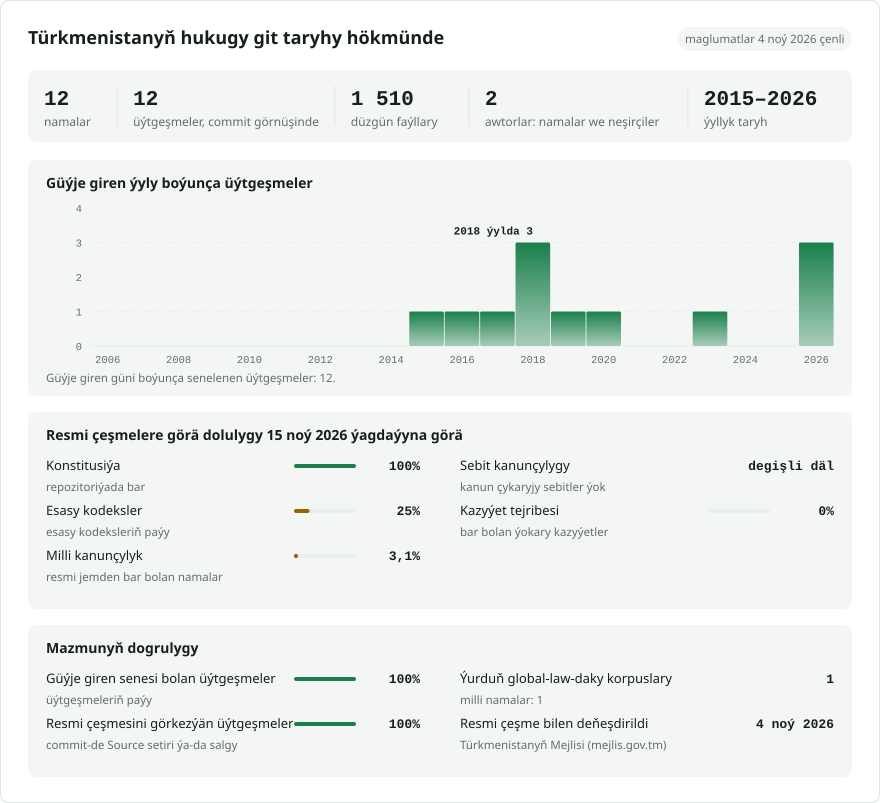

# Türkmenistan: kanunçylygyň git-däki taryhy

**Türkmen dili** · [English](README.en.md)

<picture>
<source media="(prefers-color-scheme: dark)" srcset="data/tk/effort-dark.svg">

</picture>

Türkmenistanyň kanunçylygy git taryhy görnüşinde: her madda üçin bir faýl (bütinligine saklanýan on kanun üçin her kanuna bir faýl), her wersiýa üçin onuň güýje giren gününde bir kommit, kommitiň awtory bolsa her üýtgeşmäni girizen kanun (elýeterli iň irki wersiýa üçin — neşir ediji). `git blame` her setiriň aňyrsyndaky namany görkezýär; `git log` maddanyň ähli üýtgeşmelerini sanap görkezýär; bir sene saýlanyňda şol gün güýjünde bolan tekst alynýar.

Ähli ýurtlaryň hukugy üçin ýeke-täk git taryhy bolan [lexifina/global-law](https://github.com/lexifina/global-law) taslamasynyň bölegi: bu Türkmenistanyň milli hukugy bolup, global-law ony `turkmenistan/national/acts/` ýolundan okaýar.

**Häzir onda näme bar:** Mejlisiň 12 namasy, häzirlikçe her biri bir wersiýada: Konstitusiýa (2017, 2020 we 2023-nji ýyllarda girizilen üýtgetmeler bilen 2016-njy ýylyň täze redaksiýasy), 2025-nji ýylyň 28-nji iýunyndaky, 2026-njy ýylyň 1-nji ýanwaryndan güýje giren Raýat kodeksi we 2015–2026-njy ýyllar aralygynda güýje giren on kanun, olaryň arasynda ekstremizme garşy göreş, şahsy maglumatlar, neşe serişdeleri, gan donorlygy we wirtual aktiwler hakyndaky kanunlar. [`REPRODUCE.md`](REPRODUCE.md) olary seneleri bilen sanap görkezýär; [`data/laws.csv`](data/laws.csv) ýazgyda agzalýan iki kanuny sanap görkezýär.

Konstitusiýa `konstitusiya/`, Raýat kodeksi bolsa `rayat-kodeksi/` bukjasynda ýerleşýär: her madda üçin bir faýl (`art-050.md`; 6¹-nji madda `art-006-1.md`), `preambula.md`, olaryň bölekleriniň, bölümleriniň we baplarynyň atlary `bolumler.md` faýlynda we olary sanap görkezýän `README.md`. On kanunyň her biri bir faýlda bütin resmi tekstdir: `mejlis-law-<id>/full-text.md`, bu ýerde id — kanunyň mejlis.gov.tm saýtyndaky sahypasynyň belgisi (`mejlis-law-378/` — Wirtual aktiwler hakynda Kanun).

Tekst döwlet dili bolan türkmen dilinde (Konstitusiýanyň 21-nji maddasy), Mejlisiň neşir edişi ýaly berilýär. Rus we iňlis dillerindäki tekstler bu ýazga girmeýär.

## Git buýruklary görnüşindäki soraglar

| Sorag | Buýruk |
| --- | --- |
| Konstitusiýanyň 50-nji maddasynyň (dynç alyş hukugy) ähli üýtgeşmeleri | `git log -p --word-diff -- konstitusiya/art-050.md` |
| 50-nji maddanyň her setirini haýsy nama ýazdy? | `git blame konstitusiya/art-050.md` |
| Konstitusiýanyň ähli wersiýalary, her biriniň güýje giren güni bilen | `git log --format="%h %(trailers:key=In-force,valueonly,separator=) %an" -- konstitusiya ":(exclude)konstitusiya/README.md"` |
| 2024-nji ýylyň 1-nji ýanwaryndaky güýjünde bolan 50-nji madda | `python tools/on.py 2024-01-01 konstitusiya art-050` |

**Git-den daşarda** biz bu ýazgyny mugt we hemmeler üçin açyk ýerleşdirýäris:

- **[Claude-dan Türkmenistanyň hukugy barada soraň](https://global-law.lexifina.com/v1/try_claude?country=turkmenistan)**: Claude-y taýýar ilkinji sorag bilen açýar.
- **[ChatGPT-den soraň](https://global-law.lexifina.com/v1/try_chatgpt?country=turkmenistan)**: şol bir sorag ChatGPT-de.
- **[Saýtymyzda Türkmenistanyň hukugyndan gözläň](https://lexifina.com/law?country=turkmenistan&q=miras)**: "miras" sözi boýunça gözleg, her düzgüniň teksti we wersiýalary bilen, hasap açmak gerek däl.
- **[Işläp düzüjiler üçin REST API](https://global-law.lexifina.com/v1/search_law?query=miras&jurisdiction=turkmenistan)**: şol bir gözleg JSON görnüşinde, açarsyz. [Resminamalar şu ýerde](https://lexifina.com/api/global-law).

Iki kömekçi hem ýazgyny mugt Global law birikdirijisi (MCP, `https://global-law.lexifina.com/mcp`) arkaly okaýar; ilkinji gezek çat ony goşmak üçin salgylanma berýär. Türkmen ýa-da iňlis dilinde soraň.

**Ony aňsatlyk bilen özüňiz ýerleşdiriň.** Diňe git we Python gerek, gurallar bolsa siziň kompýuteriňizde işleýär:

```sh
git clone --depth 1 https://github.com/lexifina/global-law && cd global-law
python3 tools/countries.py add turkmenistan/national/acts
python3 tools/law.py show 2024-01-01 turkmenistan/national/acts/konstitusiya/art-050.md
```

Claude Code, Cursor, VS Code ýa-da Codex-de açylanda, klon şol bir gurallar bilen ýerli MCP serweri hem işledýär ([MCP.md](https://github.com/lexifina/global-law/blob/main/MCP.md)).

## Seneler

Her kommit wersiýanyň güýje giren gününiň günortan wagty (Asia/Ashgabat) bilen senelenýär we şol güni `In-force:` treýlerinde saklaýar:

- Konstitusiýa üçin — 2023-nji ýylyň 21-nji ýanwary, onuň iň soňky üýtgetmesi bolan 531-VI belgili Konstitusion Kanunyň gol çekilen güni; onuň II bölümi ony gol çekilen gününden güýje girizýär;
- Raýat kodeksi üçin — 2026-njy ýylyň 1-nji ýanwary, Kanun № 162-VII-de görkezilen gün;
- on kanunyň her biri üçin — onuň öz jemleýji maddasynda görkezilen gün (Söwda-senagat edarasy hakyndaky Kanun üçin — 2016-njy ýylyň 1-nji ýanwary, onuň V baby hem şol gün güýje girdi).

On kanun ilkinji gurluşyň üstünden goşuldy, şonuň üçin kommitleriň tertibi seneleriň tertibine gabat gelmeýär: senäni `git log --before` bilen däl-de, `In-force:` treýlerini okaýan `tools/on.py` bilen soraň.

Raýat kodeksi ony kabul eden kanuna, Kanun № 162-VII-ä degişli edilýär. Konstitusiýa we on kanunyň her biri "elýeterli iň irki wersiýa" (oldest version available) bolup, diňe häzirki tekstleri neşir edýän neşir ediji Türkmenistanyň Mejlisine degişli edilýär. Soňraky wersiýalar her üýtgeşmäni girizen kanuna degişli ediler.

## Nähili barlanýar

- Her tekst Mejlisden iki gezek alyndy we iki gezek derňeldi; iki gezek hem şol bir düzgünler alyndy.
- `tools/check_repo.py` her wersiýany güýje giren gününde we ondan öňki günde git-den yzyna okaýar we ony özünden gurlan korpus bilen deňeşdirýär. [`REPRODUCE.md`](REPRODUCE.md) korpusyň sha256-syny berýär, emma onuň üçin barlagyň işledilişini ýa-da ikinji gurluşy entek ýazga geçirmeýär.
- Şol bir barlag her kommitiň treýlerleriniň derňelmegini, birleşdiriji (merge) kommitleriň bolmazlygyny, kommit seneleriniň yza gitmezligini we geljekki sene bilen hiç zadyň bolmazlygyny talap edýär. Taryh diňe goşulýar: neşir edilen hiç bir kommit täzeden ýazylmaýar.
- [vulnerabilities/](vulnerabilities/): bu hukukda bolup biljek redaksiýa ýalňyşlyklary, global-law detektorlary tapýar we el bilen barlanýar. Entek işledilmedi.

## Nämäni görkezmeýär

- **Hukugyň köp bölegini.** Mejlis 371 kanuny we 22 kodeksi sanap görkezýär; olaryň 12-siniň teksti şu ýerde. Zähmet kodeksi ýok; Jenaýat kodeksi entek derňelmedi, beýleki alty kodeks bolsa iň soňky üýtgetmeleriniň güýje giren güni tassyklanýança garaşýar.
- **Öňki wersiýalary.** Mejlis diňe häzirki tekstleri neşir edýär, şonuň üçin her namanyň bir wersiýasy bar; 2016-njy ýylda kabul edilen Konstitusiýa we onuň 2017 we 2020-nji ýyllardaky üýtgetmelerden soňky tekstleri şu ýerde ýok.
- **Raýat kodeksiniň 1087-nji maddasyny** aýratyn faýl hökmünde: onuň ady çeşmede ýalňyş ýazylan ("mada"), şonuň üçin onuň teksti `art-1086.md` faýlynyň ahyrynda.
- **Permanlary, kararlary, kazyýet tejribesini, ýerli namalary we halkara şertnamalary**: entek hiç biri ýok.

## Çeşmeler

| Çeşme | Görnüşi | Öňki wersiýalar | Bellikler |
| --- | --- | --- | --- |
| [Türkmenistanyň Mejlisi](https://mejlis.gov.tm/laws?lang=tm) (mejlis.gov.tm) | Kanunlaryň we kodeksleriň Mejlis tarapyndan berilýän tekstleri | ýok, diňe häzirki tekst | Bu ýerdäki her namanyň teksti |

## Ygtyýarnama

Seret: [`LICENSE`](LICENSE). Türkmenistanda kanunlar we beýleki resmi resminamalar awtorlyk hukugynyň obýekti däldir (Awtorlyk hukugy we oňa degişli hukuklar hakyndaky 2012-nji ýylyň 10-njy ýanwaryndaky 257-IV belgili Kanun, 7-nji madda); Lexifina-nyň düzüşi, kommit habarlary, tablisalary we gurallary CC0 1.0 boýunça jemgyýetçilik eýeçiligine berilýär.

Hiç bir emeli aň modeli hukuk tekstini ýazmady, terjime etmedi we düzetmedi, taryh gurlanda hem hiç biri işledilmeýär; skriptleri Claude Opus 5.5 modelinde işleýän Claude Code ýazdy, GPT-6 bolsa çykaryş we barlag kodlaryny ýazdy (seret: [`REPRODUCE.md`](REPRODUCE.md)).

Bu tekst iňlis dilindäki nusganyň ([README.en.md](README.en.md)) terjimesidir; tapawut bar bolsa, iňlis dilindäki nusga esas edilip alynýar.

## Wizuallaşdyrmalar

- [visualisations/](visualisations/): bu ammardan çekilen diagrammalar. Entek çekilmedi.

## Goşmaça maglumat

[lexifina/global-law](https://github.com/lexifina/global-law) repozitoriýasyndan (iňlis dilindäki sahypalar):

- [FEATURES.md](https://github.com/lexifina/global-law/blob/main/FEATURES.md): ähli mümkinçilikler we her korpusyň goldamaly zatlary (`git blame`, `law.py`, MCP gurallary)
- [FAQ.md](https://github.com/lexifina/global-law/blob/main/FAQ.md): soraglar we jogaplar · [CONTRIBUTING.md](https://github.com/lexifina/global-law/blob/main/CONTRIBUTING.md): üýtgeşmeleri teklip etmek · [MCP.md](https://github.com/lexifina/global-law/blob/main/MCP.md): MCP serweri · [REPRODUCE.md](https://github.com/lexifina/global-law/blob/main/REPRODUCE.md): nähili gurlandygy · [CHANGELOG.md](https://github.com/lexifina/global-law/blob/main/CHANGELOG.md)
- [FRESHNESS.md](https://github.com/lexifina/global-law/blob/main/FRESHNESS.md): her korpusyň näçe täzedigi · [Monitoring](https://github.com/lexifina/global-law/tree/main/monitoring): täzelenmeleriň işleýändigi · [WATCHING.md](https://github.com/lexifina/global-law/blob/main/WATCHING.md): her resmi çeşmäniň üýtgeşmeler üçin nähili yzarlanýandygy
- [performance/](https://github.com/lexifina/global-law/tree/main/performance): gurallaryň ölçelen tizligi
- [visualisations/](https://github.com/lexifina/global-law/tree/main/visualisations): dünýä hukugy boýunça diagrammalar we baglanyşyklar
- [Ejizlikler](https://github.com/lexifina/global-law/tree/main/vulnerabilities): neşir edilişi ýaly kanunçylykdaky ýalňyşlar
